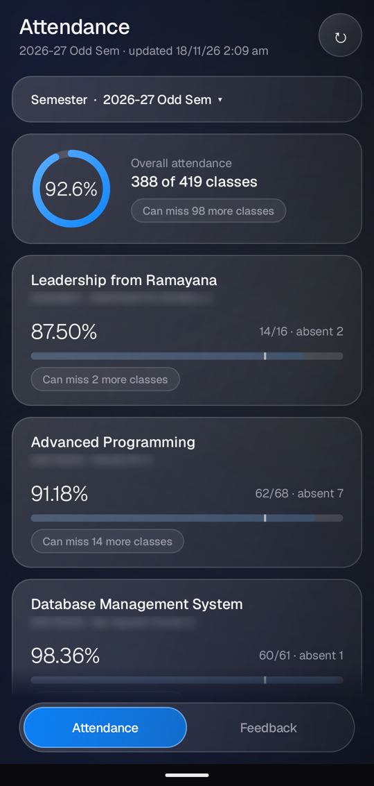
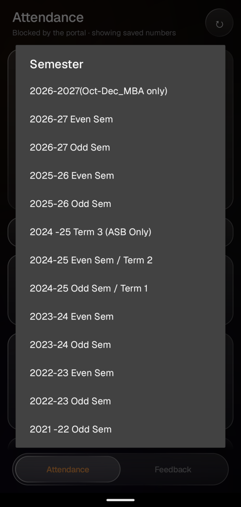
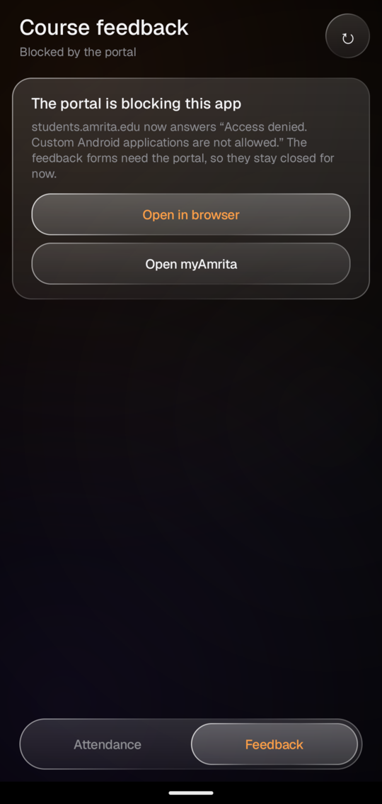

# Amrita Attendance

An Android app for the Amrita student portal. It shows your attendance without the sideways scrolling, and it fills in the course feedback forms so you don't spend an evening tapping through them.

| | | | | |
|---|---|---|---|---|
|  |  |  |  |

**[Download the APK](dist/amrita-attendance.apk)** (version 1.5, Android 8.0 or newer, arm64). Also on the [Releases page](../../releases).

## Why I built this

Course feedback goes like this. You open the list, tap Submit Feedback on a course, press Send OTP, wait for the email, type the code, and the form shows you Question 1 of 5. Pick an option. Save & Next. Question 2. Pick an option. Save & Next. Then Finish, then "Are you sure?", then back to the list, where the next course wants its own OTP and its own five questions.

A semester of courses. The class TLP forms are worse, because there is one per faculty member: one of them had 15 questions, and I had a long list of them.

It adds up to about half an hour of tapping, and I don't think anyone reads the answers. I was picking "Agree" over and over without reading the question, which is a bad way to give feedback and a worse way to spend the time.

The attendance page had a smaller problem. It sits in the Beta portal behind a Microsoft login, the table is wider than a phone screen, and to find out how many classes I could still skip I did the 75% arithmetic in my head every time. That one I got tired of too.

## The official app

myAmrita has an Android app too. In the version on my phone (1.0.18) it covers the timetable, leaves, notifications, hostel details and a month-by-month class attendance view. Its Percentage screen shows one ring per course for the semester you pick: the percentage, and nothing else. No classes attended out of total, no overall figure, no answer to "how many can I still miss". There is no feedback section at all, so the forms stay on the website, which is built for a laptop screen.

So the app does the arithmetic and the clicking. The OTP stays with you, since it goes to your email.

## The portal blocks custom apps

On 19 November 2026 students.amrita.edu started answering this app with:

> Access denied. Custom Android applications are not allowed.

That is a deliberate rule, not a parsing bug. The app no longer reads the denial page as an empty semester: both tabs show a card that says the portal is blocking the app and keeps the last numbers it saved. From Attendance, you can sign in through the embedded browser and send the table back to the app, or open the official myAmrita app.

**Desktop mode does not get around it.** Desktop mode only changes the WebView's User-Agent. An Android WebView still adds `X-Requested-With: com.ash.attendance` to every request, still carries the `wv` token in its default UA, and still sends `Sec-CH-UA` client hints that name Android WebView. Removing those would mean proxying every request through the app's own HTTP client to hide that it comes from an app — exactly the behaviour the rule exists to stop. I am not doing that.

If Amrita IT allows a student-built client or provides an API, live attendance and feedback can come back. Until then the app is a viewer for saved numbers, and the official app is one tap away.

## Browser inside the app

The **Open in app browser** button opens a browser screen powered by [Mozilla GeckoView](https://mozilla.github.io/geckoview/consumer/), the Firefox browser engine. It has an address bar, Back, Forward and Reload controls. You can sign in and open the portal without switching to Firefox or Chrome.

The browser keeps its own cookies inside the app. They are separate from the app's older WebView session and from Firefox or Chrome. The app uses GeckoView's normal page loading; it does not rewrite browser headers or user-agent strings. The portal may still block the embedded browser.

On the attendance page, the browser reads the visible table locally. Tap **Use attendance · [term]** to send it to the app, where the numbers are saved and shown in the attendance cards. There is no copy/paste step.

The app bundles [`browser/amrita-feedback.user.js`](browser/amrita-feedback.user.js) as a built-in GeckoView extension. From the feedback tab, tap **Fill feedback in the app browser**. The helper appears on matching portal pages, so there is no separate extension or bookmarklet to install.

The helper panel lets you pick a rating from 1 to 5, turn on **Finish & submit by itself**, and open the next pending form. You still press Send OTP and enter the code. The helper answers each question and saves it; with the switch on, it can also finish the form and return to the list. It makes no network requests of its own and does not touch login fields.

## What it does

Attendance

- You sign in once with your Microsoft account, inside the app. After that it opens straight to your numbers.
- One card per course: percentage, classes attended out of total, absences.
- A ring for overall attendance, and a tick at 75% on every bar.
- Tells you "Can miss 5 more classes" or "Attend next 3 classes to reach 75%". It uses present plus duty leave over total, which is how the portal gets its own percentage (I checked every course).
- Opens on the current semester, like the official app, and a picker switches to any earlier one. A pick lasts until you close the app, so the next launch starts on the current semester again.
- Keeps the last numbers, so it opens instantly with what it saw last time.
- When the portal blocks the app, says so instead of showing an empty semester, and keeps the saved numbers below the card.
- Sign in to the attendance page in the app's GeckoView browser, then tap **Use attendance · [term]** to save that page's data in the app.
- The block card also opens the official myAmrita app.

Feedback

- Course feedback and class TLP feedback as plain cards: Pending, Completed or Closed. A term picker for the older rounds.
- If the portal blocks the app's WebView, tap **Fill feedback in the app browser** to open the feedback list in GeckoView. Enter your OTP there as usual.
- Choose an answer once (1 to 5). Tapping it answers and saves every question on the form.
- An Auto-complete & submit switch. With it on, once the OTP is in, the app answers, saves, presses Finish, accepts "Are you sure?" and takes you back to the list.
- If an OTP box shows up at the end of a form, it waits for you to type the code and carries on.
- It stops and says why when something looks wrong: a save that doesn't advance, a question with fewer options than your number, a Finish you cancel.

Look and feel

- Frosted-glass cards over a quiet background, with a progress ring, bars, and cards that slide in.
- Follows the phone: black glass in dark mode, white glass in light mode.
- Adaptive launcher icon, with a themed version for Android 13 and newer.

Privacy

- The app does not store your password. Microsoft sign-in opens in a WebView for attendance and in GeckoView in the app browser; their cookies are separate.
- No server of mine, analytics, or ads. The app browser accepts HTTP and HTTPS addresses. Amrita HTTP links are upgraded to HTTPS. The feedback helper makes no network requests of its own.
- Saved numbers stay in the app's private storage on your phone.
- Plain http is blocked. The portal's http redirects are upgraded to https.

## Hostel passes and class attendance

These pages live behind the same portal and mobile API, so the same block applies. The plan, in order:

1. **Attendance** — done: saved numbers, browser handoff and official-app fallback.
2. **Class attendance by day or month** — built, untested against the real pages. The Campus tab has a month picker, month totals, a day-grouped list and the dates each course was missed. Data comes from a page you open yourself in the app browser: tap "Use this page" and the tables are read from it. Columns are found by header keywords (date, status, course, hour, month, attended, total) and cell shapes (dates, P/A/OD), in long or wide layouts, because I have not seen the real tables yet. Import one month at a time and they add up.
3. **Hostel details and passes** — built the same way, also untested against the real pages. Hostel block/room/warden, hostel attendance, the home-pass count and the gate-pass list with status pills. Read-only; any other table you open is kept as a collapsible card.
4. **Filing a home pass, gate pass or leave** — deliberately not built. A pass is a real permission to leave campus; the official app or the portal is the right place for it. An unofficial client that files one wrongly, or one the warden cannot trace, is not worth the risk. The Campus tab only links to the official route (the myAmrita app, or the portal in the app browser); it has no form that files anything.

Live campus data needs Amrita IT's permission or a supported API. The endpoint names visible in the official app are not public API documentation, and using its embedded credentials to impersonate it is off the table.

## The first test

This is the first time I ran the feedback list on my phone with Auto switched on. I tapped a pending course. Nothing happened, and the status line sat on "Opening…" for good.

Submit Feedback is a link with `target="_blank"`, which asks for a new browser tab. A WebView has no tabs, so it ignores the click. The app now reads the link's address and opens it in place.

Three other things broke before it worked at all:

1. The attendance rows are `<th>` cells, not `<td>`, so my first parser found zero courses. The page looked fine on screen, which is why it took a page dump to see it.
2. After sign-in the portal redirects to `http://`. Android refused that (`ERR_CLEARTEXT_NOT_PERMITTED`), so the attendance page never loaded.
3. The Finish button runs a JavaScript `confirm()`. A WebView cancels those unless the app handles them, so Finish did nothing until I added a dialog.

## What's tested, and what isn't

Checked on a real phone against the real portal: sign-in, the attendance numbers (the percentages match the official app's), the semester picker including a semester with no data yet, both feedback lists, and one-tap fill on a real course, where I tapped the last Save & Next and Finish myself.

Not seen working yet: tapping a pending card to open its form (the fix above is in, I haven't watched it succeed), a fully hands-free run with the switch on, the wait for an OTP at the end of a form, and everything on the class TLP forms. Nothing was pending when I wrote them, so the TLP side is written against a completed form I could only look at. I don't know what the end-of-form OTP screen looks like either. The app looks for a visible text box with "otp" in its name, id or placeholder, and if yours is called something else it will miss it. Whether it all survives a real run, we'll see.

For 1.3, ADB on a USB-connected Android phone confirmed that a portal link opened in Firefox's Custom Tab in the app's task, and Back returned to Amrita Attendance. I did not verify portal sign-in or page content.

For 1.4, I installed the 198 MB arm64 APK over USB ADB on the A059 phone (Android API 37), opened the portal through **Open in app browser**, and saw the myAmrita sign-in page inside the app. The browser close loop returned to MainActivity without a crash in three runs. I did not sign in, so the authenticated feedback page and its bundled helper remain unverified against the live portal.

For 1.5, a synthetic attendance table passed from GeckoView back to the attendance screen over USB ADB. The authenticated portal handoff still needs confirmation on a signed-in session.

For the browser helper: `./browser-test.sh` runs seven end-to-end checks in headless Chromium against `test/mock-portal.py`, a local copy of the page shapes the app was written against (userscript and bookmarklet modes, auto finish, end-of-form OTP, the loop guard, TLP, and a blocked frame). On the phone I ran a whole course in Brave against that mock with real taps, from Send OTP to Finish and back to the list. Not tested: the real portal (its markup may have moved since the block), Firefox with Violentmonkey, and whether students.amrita.edu allows itself to be framed. If it doesn't, the bookmarklet says so and points you to Firefox.

## A note on answers

The app gives every question the same answer. Choose the one you mean. The forms are for your teachers, and it's your login and your decision. This project isn't connected to Amrita, so check your college's rules before using it.

## Install

Download [`dist/amrita-attendance.apk`](dist/amrita-attendance.apk) on your phone, open it, and allow installs from your browser or file manager when Android asks. Or from a computer:

```
adb install -r dist/amrita-attendance.apk
```

It's signed with my own key, so Play Protect may complain. That's expected for an app outside the Play Store.

## Build

You need JDK 17 or newer, the Android 17 SDK (API 37 preview), Build Tools 36.0.0, and the Android SDK command-line tools. The Gradle wrapper downloads GeckoView and its Android dependencies from Mozilla's Maven repository on the first build. This build currently targets arm64-v8a, the ABI on the phone used for development.

If these Android SDK packages are missing, install them with:

```
sdkmanager --channel=3 "platforms;android-37.0" "build-tools;36.0.0"
```

```
./build.sh
```

`./browser-test.sh` rebuilds the bookmarklet and runs the browser helper against the mock portal; it needs Node 22 and Chromium.

The release build uses `~/.android/amrita-attendance.keystore` (alias `key`, password `android`) so it can update the app installed during development. Keep your signing key private if you publish your own APKs.

```
src/        MainActivity.java (screens, portal logic), Glass.java (visuals)
test/       mock portal, browser helper e2e test
browser/    feedback helper, attendance handoff, bookmarklet and GeckoView extension
assets/     generated bookmarklet used by the browser helper tests
res/        icon, theme, strings
docs/       screenshots and the IT request draft
dist/       the built APK
```

## License

MIT.
