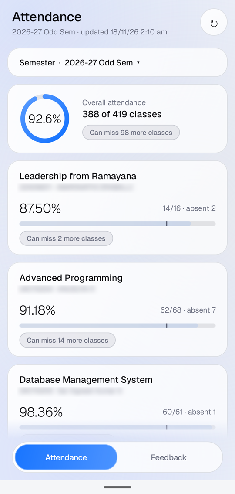
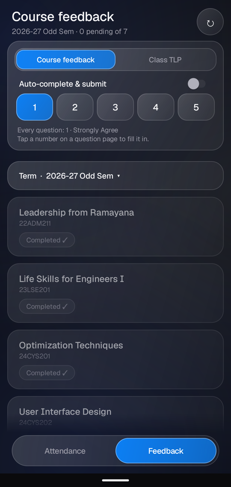
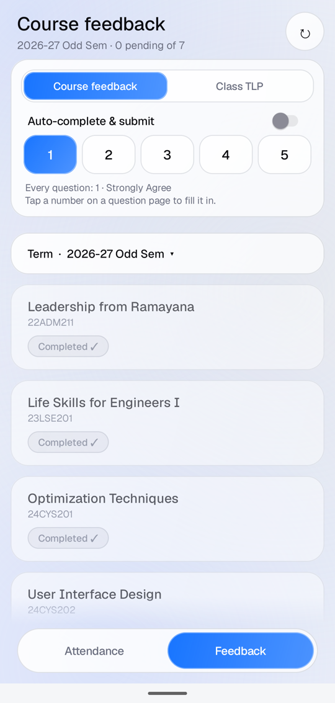
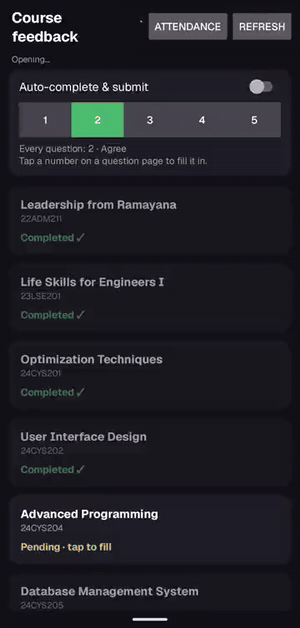

# Amrita Attendance

An Android app for the Amrita student portal. It shows your attendance without the sideways scrolling, and it fills in the course feedback forms so you don't spend an evening tapping through them.

| | | | | |
|---|---|---|---|---|
|  |  |  |  |  |

**[Download the APK](dist/amrita-attendance.apk)** (version 1.1, Android 7.0 or newer, 38 KB). Also on the [Releases page](../../releases).
SHA-256: `e4d00ff27583893247191f4cc62990db8a1817f3711b2e5cd5f164071888b120`

## Why I built this

Course feedback goes like this. You open the list, tap Submit Feedback on a course, press Send OTP, wait for the email, type the code, and the form shows you Question 1 of 5. Pick an option. Save & Next. Question 2. Pick an option. Save & Next. Then Finish, then "Are you sure?", then back to the list, where the next course wants its own OTP and its own five questions.

Seven courses this semester. The class TLP forms are worse, because there is one per faculty member: one of them has 15 questions, and I have eleven of those.

It adds up to about half an hour of tapping, and I don't think anyone reads the answers. I was picking "Agree" over and over without reading the question, which is a bad way to give feedback and a worse way to spend the time.

The attendance page had a smaller problem. It sits in the Beta portal behind a Microsoft login, the table is wider than a phone screen, and to find out how many classes I could still skip I did the 75% arithmetic in my head every time. That one I got tired of too.

## The official app

myAmrita has an Android app too. In the version on my phone (1.0.18) it covers the timetable, leaves, notifications, hostel details and a month-by-month class attendance view. Its Percentage screen shows one ring per course for the semester you pick: the percentage, and nothing else. No classes attended out of total, no overall figure, no answer to "how many can I still miss". There is no feedback section at all, so the forms stay on the website, which is built for a laptop screen.

So the app does the arithmetic and the clicking. The OTP stays with you, since it goes to your email.

## What it does

Attendance

- You sign in once with your Microsoft account, inside the app. After that it opens straight to your numbers.
- One card per course: percentage, classes attended out of total, absences.
- A ring for overall attendance, and a tick at 75% on every bar.
- Tells you "Can miss 5 more classes" or "Attend next 3 classes to reach 75%". It uses present plus duty leave over total, which is how the portal gets its own percentage (I checked all eight courses).
- Opens on the current semester, like the official app, and a picker switches to any earlier one. A pick lasts until you close the app, so the next launch starts on the current semester again.
- Keeps the last numbers, so it opens instantly with what it saw last time.

Feedback

- Course feedback and class TLP feedback as plain cards: Pending, Completed or Closed. A term picker for the older rounds.
- Tap a pending card and the form opens in the app. Enter your OTP as usual.
- Choose an answer once (1 to 5). Tapping it answers and saves every question on the form.
- An Auto-complete & submit switch. With it on, once the OTP is in, the app answers, saves, presses Finish, accepts "Are you sure?" and takes you back to the list.
- If an OTP box shows up at the end of a form, it waits for you to type the code and carries on.
- It stops and says why when something looks wrong: a save that doesn't advance, a question with fewer options than your number, a Finish you cancel.

Look and feel

- Frosted-glass cards over a quiet background, with a progress ring, bars, and cards that slide in.
- Follows the phone: black glass in dark mode, white glass in light mode.
- Adaptive launcher icon, with a themed version for Android 13 and newer.

Privacy

- It never sees your password. You sign in on Microsoft's own page, shown in a WebView.
- No server of mine, no analytics, no ads. The only permission is INTERNET, and it only talks to students.amrita.edu and Microsoft's sign-in.
- Saved numbers stay in the app's private storage on your phone.
- Plain http is blocked. The portal's http redirects are upgraded to https.

## The first test

This is the first time I ran the feedback list on my phone with Auto switched on. I tapped Advanced Programming. Nothing happened, and the status line sat on "Opening…" for good.



[Watch it as a video](docs/first-test.mp4) (15 seconds, taken from a longer recording).

Submit Feedback is a link with `target="_blank"`, which asks for a new browser tab. A WebView has no tabs, so it ignores the click. The app now reads the link's address and opens it in place.

Three other things broke before it worked at all:

1. The attendance rows are `<th>` cells, not `<td>`, so my first parser found zero courses. The page looked fine on screen, which is why it took a page dump to see it.
2. After sign-in the portal redirects to `http://`. Android refused that (`ERR_CLEARTEXT_NOT_PERMITTED`), so the attendance page never loaded.
3. The Finish button runs a JavaScript `confirm()`. A WebView cancels those unless the app handles them, so Finish did nothing until I added a dialog.

## What's tested, and what isn't

Checked on a real phone against the real portal: sign-in, the attendance numbers (the percentages match the official app's), the semester picker including a semester with no data yet, both feedback lists, and one-tap fill on a real course, where I tapped the last Save & Next and Finish myself.

Not seen working yet: tapping a pending card to open its form (the fix above is in, I haven't watched it succeed), a fully hands-free run with the switch on, the wait for an OTP at the end of a form, and everything on the class TLP forms. Nothing was pending when I wrote them, so the TLP side is written against a completed form I could only look at. I don't know what the end-of-form OTP screen looks like either. The app looks for a visible text box with "otp" in its name, id or placeholder, and if yours is called something else it will miss it. Whether it all survives a real run, we'll see.

## A note on answers

The app gives every question the same answer. Choose the one you mean. The forms are for your teachers, and it's your login and your decision. This project isn't connected to Amrita, so check your college's rules before using it.

## Install

Download [`dist/amrita-attendance.apk`](dist/amrita-attendance.apk) on your phone, open it, and allow installs from your browser or file manager when Android asks. Or from a computer:

```
adb install -r dist/amrita-attendance.apk
```

It's signed with my own key, so Play Protect may complain. That's expected for an app outside the Play Store.

## Build

You need a JDK 21 and the Android SDK with platform 34, build-tools 34.0.0 and the command-line tools. There is no Gradle: `build.sh` calls `aapt2`, `javac`, `d8` and `apksigner` directly.

```
./build.sh
```

The SDK's own d8 crashed under the default JDK here, so the script runs the newer d8 from the command-line tools. On first run it creates a keystore at `~/.android/amrita-attendance.keystore` with the password `android`. Change that before you share a build.

```
src/        MainActivity.java (screens, portal logic), Glass.java (the visual toolkit)
res/        icon, theme, strings
docs/       screenshots and the first-test clip
dist/       the built APK
```

## License

MIT. Made by Ashvinsai.
